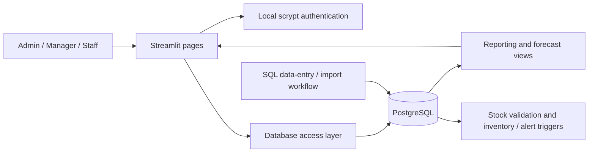

# FinVentory Intelligence

**Inventory analytics, financial reporting and demand forecasting with Python, PostgreSQL and Streamlit.**

FinVentory turns sales, purchases, stock and expense records into a business dashboard. It combines SQL reporting views, database triggers and a role-aware Streamlit interface to help a small business review stock risk, product performance and profitability.

Built as a team project for the Database Systems course at **FAST NUCES Karachi**.

[Setup guide](docs/SETUP.md) · [Architecture](docs/ARCHITECTURE.md) · [Demo walkthrough](docs/DEMO.md) · [Reporting logic](docs/REPORTING.md) · [Validation](VALIDATION.md) · [Resume & interview notes](docs/PORTFOLIO.md)

> The documented implementation is on `repair/finventory-critical-fixes-2026-11` while [PR #1](https://github.com/Talha2555/FinVentory-Intelligence/pull/1) awaits review. `main` has not been merged or modified by that repair.

## What the project demonstrates

| Capability | Implementation |
| --- | --- |
| Business dashboard | Product, supplier and retailer rankings plus monthly revenue charts. |
| Inventory monitoring | Purchase/sale insert triggers update stock; stock validation locks inventory rows and rejects insufficient stock. |
| System alerts | Low-stock and high-expense alerts, with an interactive stock scan. |
| Demand forecasting | Three completed calendar months weighted 50/30/20, including zero-sales months. |
| Profit reporting | Line-item revenue, sale-time cost snapshots, gross profit, expenses and net profit. |
| Role-aware access | Admin financial/ledger pages; shared dashboard, inventory and forecasting pages for Admin, Manager and Staff. |
| Authentication | Private local account files with salted scrypt password hashes and a setup CLI. |
| Reliability | Environment-based configuration, transaction rollback, connection cleanup and sanitized database errors. |
| Automated validation | 18 tests across unit, Streamlit and PostgreSQL integration coverage; GitHub Actions runs against PostgreSQL 17. |

The forecast is a transparent weighted moving average. The interface retains its original “AI” page label; the implementation does not train a machine-learning model or claim measured predictive accuracy.

## Technology

- **Application:** Python 3.12, Streamlit, Pandas.
- **Database:** PostgreSQL, PL/pgSQL functions/triggers, SQL views and stored procedures, psycopg2.
- **Visualization:** Matplotlib and Seaborn.
- **Quality:** pytest, Streamlit AppTest, disposable PostgreSQL schemas and GitHub Actions.

## Run locally

Follow the [setup guide](docs/SETUP.md) for PostgreSQL provisioning, private environment settings and account creation. After that setup:

```bash
python -m venv .venv
source .venv/bin/activate
pip install -r requirements.txt
streamlit run app.py
```

A fresh database loads `finventory.sql` through `psql`; optional sample records are in `demo_data.sql`. Existing installations use the documented migration instead. No default login accounts or passwords are shipped.

## Architecture at a glance



Business records are entered through SQL/import workflows; the current Streamlit application focuses on reporting and alert scans. Ledger procedures must be called explicitly when recording sales/purchases. See the [architecture and data model](docs/ARCHITECTURE.md) for the transaction boundaries.

## Validation

**18 tests passed with no skips** using Python 3.12.14 and PostgreSQL 17.11. PostgreSQL-backed GitHub Actions also passed for repair commit `9692dc9`.

```bash
pip install -r requirements-dev.txt
python -m pytest -q
```

Set `TEST_DATABASE_URL` to a disposable database and install `psql` to run the integration tests; otherwise those tests explicitly skip. Full evidence, commands and exclusions are in [VALIDATION.md](VALIDATION.md).

## Scope and next steps

This is a tested course/portfolio application. It has not been verified against a production database or under concurrent-user load. The local CSV authentication design suits a controlled demonstration; hosted identity, account recovery and login rate limiting remain future work. Historical cost backfills require reconciliation, and posted-line edits/deletes do not reverse stock automatically.

Potential extensions include audited returns/corrections, sales-entry forms, ledger reconciliation, hosted identity, and forecast backtesting against a baseline. See [reporting definitions](docs/REPORTING.md) for current accounting boundaries.

## Team

Talha Khan · Muhammad Siraj · Muhammad Furqan · Maaz Umer

When presenting this team project, describe your own contributions explicitly. [Portfolio notes](docs/PORTFOLIO.md) provide supported resume language and interview talking points.
