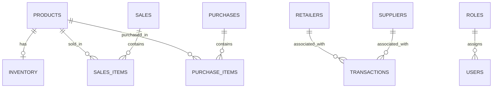

# Architecture and data model

FinVentory is a Python reporting application backed by PostgreSQL. Business logic is split between database reporting/stock routines and a thin Streamlit interface.

## Repository map

| Path | Responsibility |
| --- | --- |
| `app.py` | Login, role-based navigation, charts, reporting tables and alert-scan action. |
| `auth.py` | Salted scrypt password verification and privately prompted account-creation CLI. |
| `database.py` | Environment-based connection settings, bound parameters, transaction handling and cleanup. |
| `finventory.sql` | Transactional fresh schema, stock/alert triggers, ledger procedures and view inclusion. |
| `views.sql` | Canonical dashboard, finance and forecast views shared by install and migration. |
| `demo_data.sql` | Optional fixed-date sample products, opening inventory, sales, purchases, parties and expenses. |
| `migrations/` | Upgrade path from the original schema, including historical cost backfill. |
| `tests/` | Authentication/database unit tests, Streamlit AppTest and real PostgreSQL integration tests. |
| `.github/workflows/tests.yml` | Python 3.12 test job with a PostgreSQL 17 service. |

## Main relationships

The diagram shows intended relationships; the original schema permits nulls on some foreign-key columns. Transaction `reference_id` stores a sale or purchase ID by convention, without a polymorphic foreign-key constraint. Purchases retain a text supplier field; reporting party relationships come from explicit ledger IDs. Expenses and alerts are independent tables. Reserved `demand_predictions` and SQL `users` tables are not read by the current forecast/authentication paths.

## Read path

1. Streamlit verifies a password against the configured private CSV and stores the role in session state.
2. Navigation exposes shared pages to all supported roles and financial/ledger pages to Admin.
3. Each query opens a fresh PostgreSQL connection, fetches results into a DataFrame, and closes the connection.
4. The interface renders metrics, tables and plots. Driver failures stop the affected read path with a generic message; SQLSTATE codes are logged without driver text.

Role controls live in the application navigation. All signed-in roles currently use the same configured database login; this is not PostgreSQL row-level security or independent per-user database authorization.

## Write paths and transaction boundaries

The interface's alert scan updates inventory quantities to themselves to invoke stock alerts. Successful updates commit; failed updates roll back. The trigger suppresses repeated unread low-stock messages for the same product.

For SQL/imported sales, a BEFORE INSERT trigger locks the product's inventory row, rejects insufficient/missing stock, and fills a missing `unit_cost` from product cost. An AFTER INSERT trigger decreases stock. Purchase-item inserts increase existing stock rows. High-expense inserts create alerts. Product and inventory records must be provisioned before recording movements.

Call the relevant ledger procedure once in the **same transaction** as the business write. Header totals and ledger references are not automatically reconciled by the schema. Insert workflows are supported; correcting/deleting posted records requires an additional audited workflow.

## Financial and forecast design

Sale-time cost snapshots prevent later product-cost edits from rewriting past COGS. Revenue and COGS both derive from sale lines, while operating expenses are aggregated separately to avoid join multiplication. The forecast cross-joins products with three calendar months before aggregating, keeping missing months at zero. [Reporting definitions](REPORTING.md) include formulas and worked examples.

## Configuration and credentials

`DATABASE_URL` takes precedence; otherwise standard PostgreSQL environment variables and libpq defaults apply. Each operation owns its connection, cursor and transaction. Password hashes are salted scrypt values; the account CLI writes a private file atomically. No default accounts are installed. See [setup](SETUP.md) for grants, environment variables and migration instructions.
